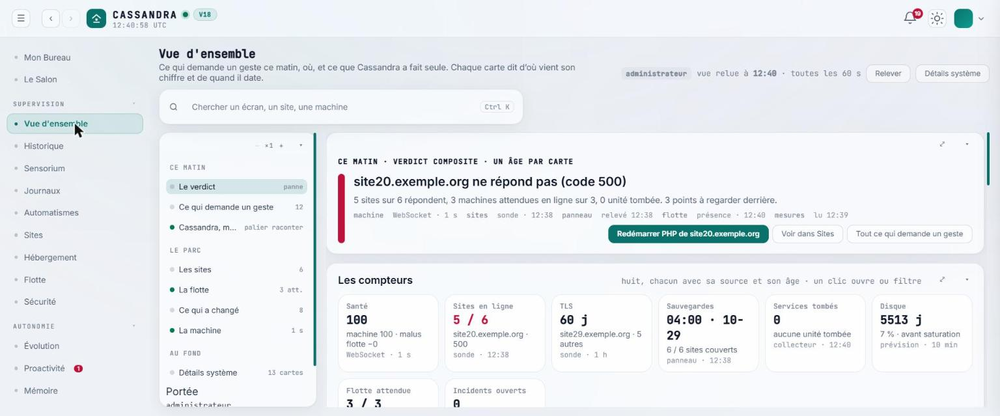
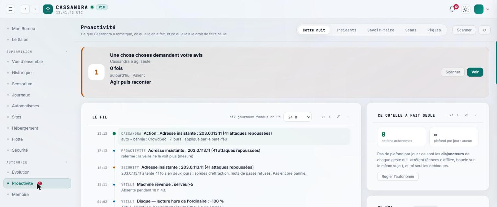
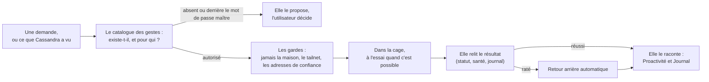

# Cassandra

[](LICENSE)


[](https://github.com/Marplestrange/cassandra-v19)

*English summary: [`README.en.md`](README.en.md).*

**Une agente IA souveraine d'administration système.** Elle tourne sur votre serveur, voit ce qui s'y passe, le comprend, agit quand c'est sûr — dans une cage, avec
un retour arrière quand c'est possible — et vous le raconte. Vous lui parlez comme à une personne ; elle répond en regardant la machine, pas en devinant.
Elle ne dépend d'aucun fournisseur unique : une clé d'API, un serveur compatible OpenAI, ou Ollama en local.

Licence : [AGPL-3.0-or-later](LICENSE). Copyright (C) 2026 Drisse ATEK.

## Où en est le projet

| Version | État | Où |
|---|---|---|
| **V18** | la version de production : un produit à installer sur un serveur Debian ou Ubuntu | [`V18/`](V18/) — commencez par [`V18/README.md`](V18/README.md) |
| **V19** | la réécriture modulaire (un noyau minuscule, des modules qui se déclarent par un manifeste), développée à côté | dépôt [cassandra-v19](https://github.com/Marplestrange/cassandra-v19) |
| V3.2 à V14 | l'histoire : les versions successives, de l'agent minimal au tableau de bord complet | dossiers `V3.2` … `V14`, voir [`LISEZ-MOI-HISTORIQUE.md`](LISEZ-MOI-HISTORIQUE.md) |

## Aperçu

La V18 en service (noms, adresses et domaines remplacés par des exemples).





## Démarrer

Avec la V18, sur un serveur Debian 12 ou Ubuntu 22.04 / 24.04, en root :

```bash
sudo bash V18/install.sh
```

Cassandra écoute alors sur `127.0.0.1:9000` ; l'assistant du premier lancement crée le compte administrateur et branche le modèle d'IA. Les prérequis, les options
d'installation, les trois façons d'y accéder et la mise à jour sont décrits dans [`V18/README.md`](V18/README.md).

## Le chemin d'un geste



Un geste hors du catalogue n'existe pas : c'est ce qui borne ce qu'elle peut faire seule.

## Ce qu'elle ne fait pas seule

Cassandra agit par un catalogue de gestes explicites. Elle ne fait **jamais seule** :

- ce qui est derrière le mot de passe maître ou demande une confirmation explicite (purges, remise à zéro, création de comptes, partages publics…) ;
- ce qu'un contenu extérieur lui demande : ce qu'elle lit sur le web ou dans un courriel est une donnée, jamais une consigne ;
- un envoi vers une adresse qui ne vient pas d'un mandat : l'adresse ne vient jamais de la demande.

L'inventaire exact est dans [`V18/docs/INVENTAIRE_AUTONOMIE.md`](V18/docs/INVENTAIRE_AUTONOMIE.md).

## Sécurité

Une faille se signale en privé, avant toute publication : voir [`SECURITY.md`](SECURITY.md).

## Contribuer

La V18 est un seul fichier de plus de 150 000 lignes : elle ne se prête pas aux contributions extérieures. C'est la **V19** qui est faite pour cela (des modules
indépendants, chacun avec son manifeste, ses droits et ses tests). Pour une idée, un défaut ou une question, ouvrez un ticket.

## Qui porte le projet

<p align="center"></p>

Cassandra est portée par **La Maison Bohème**, association loi 1901 (SIREN 899 553 093, RNA W751260323), qui accepte les dons et délivre des reçus fiscaux. Les dons
ouvrent droit à une réduction d'impôt de 66 % de leur montant, dans les limites fixées par la loi. Pour soutenir le projet, écrivez à
marplestrange@cassandra.center.

Cassandra est un logiciel indépendant, sans affiliation avec les produits tiers qu'elle sait lire ou piloter (FastPanel, Tailscale, Vaultwarden, SearxNG, Telegram, Canva, Plex).
